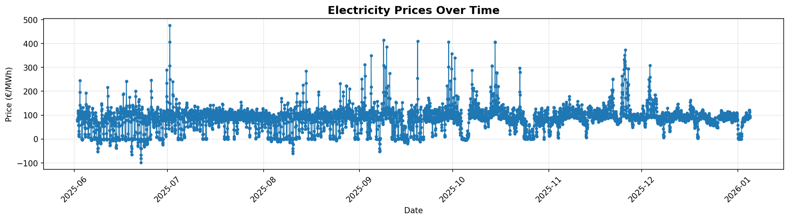
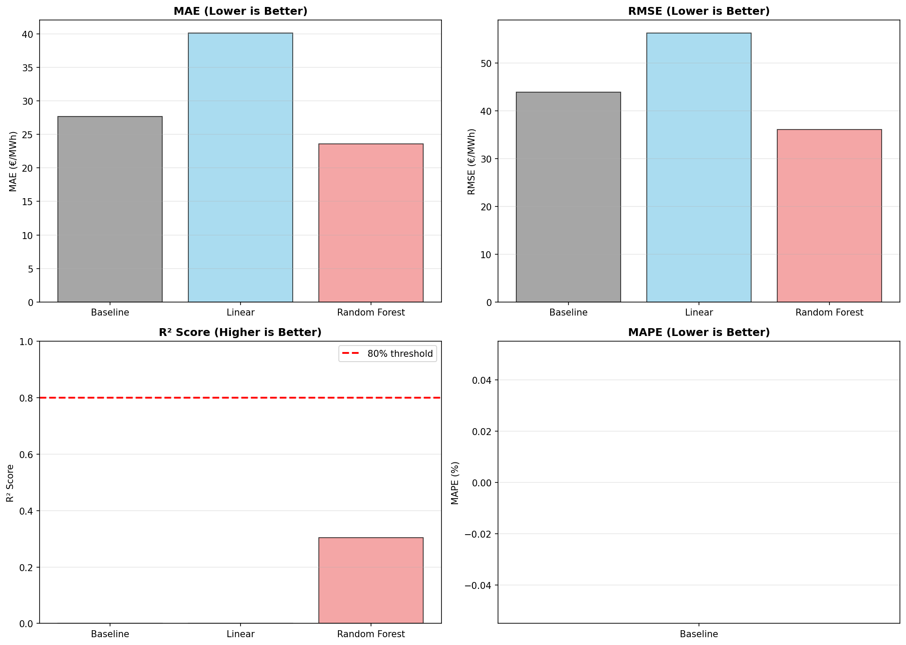
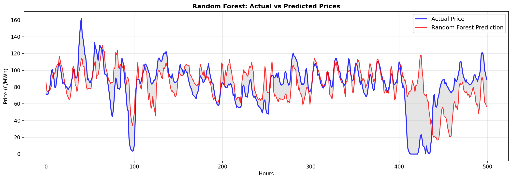
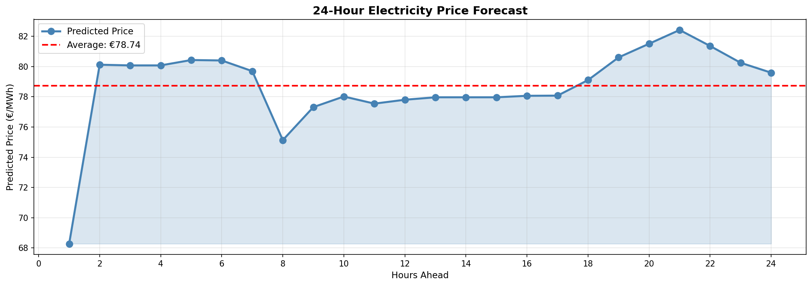

# ⚡ German Electricity Price Forecasting
### End-to-end ML pipeline | SMARD API | 24-hour ahead predictions | Random Forest


> Predict German electricity spot prices 24 hours ahead using publicly available SMARD market data, feature engineering, and machine learning.

---

## 📸 Project Visuals

| Plot | Description |
|------|-------------|
| `plots/01_timeseries.png` | Full price time series (Jun–Dec 2025) |
| `plots/02_hourly_pattern.png` | Average price by hour of day ± std |
| `plots/03_distribution.png` | Price distribution histogram |
| `plots/04_feature_correlation.png` | Top 15 features correlated with target |
| `plots/05_model_comparison.png` | MAE / RMSE / R² / MAPE across models |
| `plots/06_predictions_vs_actual.png` | Predicted vs actual prices (test set) |
| `plots/07_residuals_analysis.png` | Residual distribution + scatter |
| `plots/08_24hour_forecast.png` | 24-hour ahead forecast visualization |

**Time Series Overview**


**Model Comparison**


**Predictions vs Actual**


**24-Hour Forecast**


---

## 🎯 Project Goal

Electricity prices on the German EPEX SPOT market are highly volatile - influenced by renewable generation, cross-border flows, demand cycles, and weather. Accurate short-term price forecasting has direct commercial value for:

- **Energy traders** optimising buy/sell decisions
- **Industrial consumers** scheduling flexible loads
- **Grid operators** balancing supply/demand
- **Renewable asset owners** maximising revenue

This project builds a complete pipeline from raw API data to a deployed forecasting function, using only publicly available data from **[SMARD.de](https://www.smard.de)** - the official German electricity market transparency portal.

---

## 🎯 Why I built this?
I wanted to work on a project in which I own the whole workflow on real data, from API call to forecast, and where honest evaluation matters. Day-ahead prices are a good test for that: a naive "same as the last known price" baseline is surprisingly hard to beat. I chose the German day-ahead market because the data is official, public, hourly and needs no API key, and because the price is driven by physical things: renewable generation, demand cycles and cross-border coupling.

---

## 📊 Dataset

| Field | Value |
|-------|-------|
| **Source** | [SMARD.de](https://www.smard.de) - Federal Network Agency (Bundesnetzagentur) |
| **Series ID** | 4169 - Day-Ahead Auction prices (EPEX SPOT, Germany/Luxembourg) |
| **Granularity** | Hourly |
| **Period** | June 2025 - December 2025 |
| **Records** | 5,209 hourly observations |
| **Unit** | €/MWh |
| **Access** | Free, public REST API (no authentication required) |

**Why SMARD?**
- Official government data - no scraping, no terms-of-service concerns
- Real market prices (EPEX SPOT Day-Ahead Auction)
- Reflects Germany's complex grid: high renewables penetration, cross-border interconnections
- Data is granular enough for hour-level patterns while covering enough time for weekly/seasonal features

---

## 🔧 Feature Engineering

50 features across 7 categories:

| Category | Count | Examples |
|----------|-------|---------|
| Time features | 7 | `hour`, `day_of_week`, `is_weekend`, `is_night` |
| Cyclical encoding | 4 | `hour_sin`, `hour_cos`, `month_sin`, `month_cos` |
| Lag features | 9 | `price_lag_1`, `price_lag_24`, `price_lag_168` (1 week) |
| Rolling statistics | 20 | mean, std, min, max, median over 6/12/24/48h windows |
| Rate of change | 4 | `price_change_1h`, `price_change_24h`, `price_pct_change_24h` |
| Range features | 3 | `price_range_12`, `price_range_24`, `price_range_48` |
| Volatility | 3 | `volatility_12`, `volatility_24`, `volatility_48` |

**Target variable:** `price` shifted 24 hours forward → predicting tomorrow's price from today's data.

---

## 📈 Model Results

| Model | MAE (€/MWh) | RMSE (€/MWh) | R² | vs Baseline |
|-------|-------------|--------------|-----|-------------|
| **Baseline** (last known price) | 27.64 | 43.98 | -0.03 | — |
| Linear Regression | 40.08 | 56.27 | -0.69 | -45% ❌ |
| **Random Forest** ✅ | **23.55** | **36.10** | **0.30** | **+14.8%** |
| XGBoost | — | — | — | Not run* |

*XGBoost was not installed in the test environment. Install with `pip install xgboost` and it will run automatically in notebook 4.

**Top 5 Features by Importance (Random Forest):**
1. `price_lag_1` - 0.2975
2. `price_change_6h` - 0.1813
3. `price_lag_72` - 0.0452
4. `day_of_week` - 0.0373
5. `price_lag_168` - 0.0308

### ⚠️ Honest Limitations

**Linear Regression underperformed the baseline.** With 50 features, many of which are strongly correlated (multicollinearity), linear regression struggled. This is expected and is a good argument for tree-based methods in non-linear price data.

**MAPE = ∞ for all models.** The dataset contains near-zero or negative electricity prices (a real phenomenon in Germany during renewable oversupply - solar/wind can push prices below zero). Division by near-zero blows up MAPE. A robust metric like sMAPE should be used instead in future iterations.

**R² = 0.30 is a starting point.** 24-hour ahead price forecasting is genuinely hard. External regressors (solar/wind generation forecasts, temperature, cross-border flows) would significantly improve performance.

---

## 🎯 Scope of the data: why 5,209 hourly observations
The dataset is about seven months of hourly day-ahead prices (June–December 2025) from SMARD series 4169. This was the window I had downloaded when I started building the pipeline as I wanted the most recent months. I treated it as a first iteration: enough hours to build 168-hour lags and 48-hour rolling windows and still keep a test set, and small enough to iterate quickly in notebooks.

What this scope costs, and what I would not claim from it:
- **Less than one seasonal cycle** The data runs from summer into early winter, so the model cannot learn a full annual pattern; month_sin / month_cos see each month only once.
- **Rows are lost to the features** A 168-hour lag and the 24-hour target shift remove the first and last rows, so the usable table is shorter than 5,209 rows.
- **A short test set** The 14.8% improvement over the baseline is therefore an estimate with real uncertainty, not a settled number.
- **A market change inside the data** Since 1 October 2025, the German day-ahead auction trades in 15-minute products; hourly prices are the average of four quarter-hours. Any difference in price behaviour before and after that date is mixed into the results.

**A personal note**-
Since this was my first end-to-end forecasting project, I learnt three main things from it:
1. To build the naive baseline first, because it tells you whether anything you do is real.
2. To check that your metric survives your data (MAPE did not).
3. To remember that the data window decides what you may conclude.

**How I would improve it next**
1. **More history** - Several years of data, so that every season, holiday pattern and the October 2025 market change are covered, and a proper long test period is included.
2. **Walk-forward validation** - Use TimeSeriesSplit instead of a single split, with confidence intervals for the MAE.
3. **External drivers** - To include wind and solar generation and their forecasts, temperature, load and cross-border flows; these are what move prices.
4. **Better metrics and models** - sMAPE next to MAE, gradient boosting (LightGBM / XGBoost), and quantile forecasts that express uncertainty.

---

## 🚀 Quickstart

### 1. Clone and install

```bash
git clone https://github.com/YOUR_USERNAME/smard-electricity-forecast.git
cd smard-electricity-forecast
pip install -r requirements.txt
```

### 2. Run notebooks in order

```bash
jupyter notebook
```

Open and run sequentially:
1. `notebooks/01_data_collection.ipynb` → downloads data to `data/`
2. `notebooks/02_eda.ipynb` → generates plots 1–3
3. `notebooks/03_feature_engineering.ipynb` → generates `data/features.csv` + plot 4
4. `notebooks/04_modeling.ipynb` → trains models, saves to `models/`, generates plots 5–7
5. `notebooks/05_deployment.ipynb` → generates 24-hour forecast + plot 8

### 3. Use the prediction function directly

```python
from src.predict import load_model, make_prediction
import pandas as pd

df = pd.read_csv("data/electricity_prices_clean.csv")
df["timestamp"] = pd.to_datetime(df["timestamp"])

model, scaler, feature_names = load_model()

# Predict price 6 hours ahead
result = make_prediction(df, model, feature_names, hours_ahead=6)
print(f"Predicted price in 6h: €{result['predicted_price']:.2f}/MWh")
print(f"Change from current: {result['pct_change']:+.1f}%")
```

---

## 🛠️ Tech Stack

| Tool | Purpose |
|------|---------|
| `pandas` | Data manipulation |
| `numpy` | Numerical computing |
| `scikit-learn` | ML models, preprocessing, metrics |
| `xgboost` | Gradient boosting (optional) |
| `matplotlib` | Visualisation |
| `requests` | SMARD API client |
| `pickle` | Model serialisation |

---

## 📄 License

MIT - free to use, modify, and share with attribution.

---

## 🙏 Acknowledgements

Data sourced from **SMARD** (Strommarktdaten), operated by the German Federal Network Agency (Bundesnetzagentur). All price data reflects official EPEX SPOT Day-Ahead Auction results.
